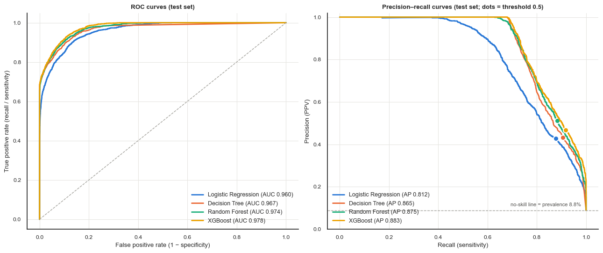
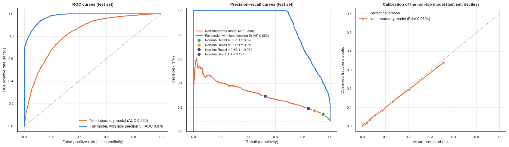

# Diabetes Prediction: from lab-based classification to pre-test screening

An end-to-end clinical machine-learning analysis of 100,000 patient records. It covers data-quality
investigation, leak-free model comparison, probability calibration, clinically motivated threshold
selection, SHAP interpretation, and a **screening model that needs no blood test**.

The analysis is written from a clinician / data-analyst perspective: every result in the notebook is
followed by a short interpretation of what it means clinically.

➡️ **Full analysis:** [`Notebook/analysis.ipynb`](Notebook/analysis.ipynb)

---

## Key findings

| Question | Answer |
|---|---|
| Best model with lab values | Calibrated **XGBoost**: PR-AUC 0.88, ROC-AUC 0.98 (held-out test set) |
| Screening threshold with labs | Risk ≥ 0.07 → recall 0.94, NPV 99.4%, 2.4 patients flagged per case found |
| Most important predictors | HbA1c and blood glucose (step-like effects at the diagnostic cut-offs), then age and BMI |
| Without any blood test | PR-AUC 0.31, ROC-AUC 0.83, well calibrated |
| Pre-test triage rule | Risk ≥ 0.03 → test 57% of patients and find **95% of diabetics**; the other 43% can skip the test (NPV 98.9%) |



## Data

**Source:** [Diabetes prediction dataset](https://www.kaggle.com/datasets/iammustafatz/diabetes-prediction-dataset)
by Mohammed Mustafa, on Kaggle (licence: *Data files © Original Authors*). The data is **not included**
in this repository out of respect for that licence. To run the notebook:

1. Download `diabetes_prediction_dataset.csv` from the Kaggle page above (a free Kaggle account is needed).
2. Save it as `Data/raw/diabetes_prediction_dataset.csv`.

100,000 rows, 9 columns: `gender`, `age`, `hypertension`, `heart_disease`, `smoking_history`, `bmi`,
`HbA1c_level`, `blood_glucose_level` and the target `diabetes` (8.8% positive).

### Data-quality findings

- **3,854 exact duplicate rows**: almost all share the same BMI value and are probably distinct patients
  who collide by chance. They were dropped, and a sensitivity analysis shows this changes nothing.
- **Hidden missing values:** 22.5% of rows have BMI = 27.32, the exact column mean, so these values are
  mean-imputed. The rows are kept and flagged with a `bmi_imputed` indicator.
- **Rule-like labels:** HbA1c ≥ 6.8% or glucose ≥ 220 mg/dL means *always* diabetic, and HbA1c ≤ 5.0% or
  glucose ≤ 100 mg/dL means *never* diabetic. The dataset is therefore probably partly synthetic.

## Methods

1. **Exploratory analysis and data quality**: duplicates, hidden missingness, class imbalance, and
   univariate and bivariate analysis.
2. **Baseline**: Logistic Regression with odds ratios.
3. **Model comparison**: Logistic Regression, Decision Tree, Random Forest and XGBoost in scikit-learn
   `Pipeline`s (no preprocessing leakage). Stratified 80/20 split, class weighting, light `GridSearchCV`
   on PR-AUC, and 5-fold stratified cross-validation plus a held-out test set.
4. **Calibration and threshold selection**: isotonic against sigmoid calibration, with thresholds chosen
   from out-of-fold training predictions and applied **once** to the test set.
5. **Interpretation and robustness**: TreeSHAP feature importance, and sensitivity analyses for the
   duplicate, BMI-imputation and outlier decisions.
6. **Non-laboratory screening model**: the same pipeline without HbA1c and glucose. It answers the
   clinically more relevant question *"who should be sent for a blood test?"* and avoids the circularity
   of predicting a diagnosis from the test that defines it.



## Limitations

- The labels look rule-generated, so the very high scores of the lab-based model measure how well it
  recovers that rule, not expected real-world performance.
- HbA1c and glucose are themselves diagnostic criteria (incorporation bias). Section 6 addresses this
  with the non-laboratory model.
- BMI mean imputation, a third of smoking histories missing, no ethnicity or family history, and
  cross-sectional data.
- Internal validation only: no external dataset, and calibration is tied to this dataset's 8.8% prevalence.

The full discussion is in section 7 of the notebook.

## How to run

Requires Python 3.10.

```bash
git clone https://github.com/Aaminvh/Diabetes-prediction.git
cd Diabetes-prediction
python -m venv .venv
# Windows: .venv\Scripts\activate    macOS/Linux: source .venv/bin/activate
pip install -r Notebook/requirements.txt

# download the CSV from Kaggle into Data/raw/ first (see "Data" above)
cd Notebook
jupyter lab analysis.ipynb
# or run headless:
jupyter nbconvert --to notebook --execute analysis.ipynb
```

The notebook must be run from the `Notebook/` folder, because it loads the data with a relative path.
A full run takes about 3 minutes.

## Project structure

```
├── Data/
│   ├── raw/          place diabetes_prediction_dataset.csv here (download from Kaggle)
│   └── processed/    generated files (not tracked)
├── Notebook/
│   ├── analysis.ipynb
│   └── requirements.txt
├── figures/          figures exported from the notebook
└── Outputs/          model artefacts (not tracked)
```

## Tech stack

Python · pandas · NumPy · scikit-learn · XGBoost · imbalanced-learn · matplotlib · seaborn · Jupyter

## Author

**Amin Vahdati**
